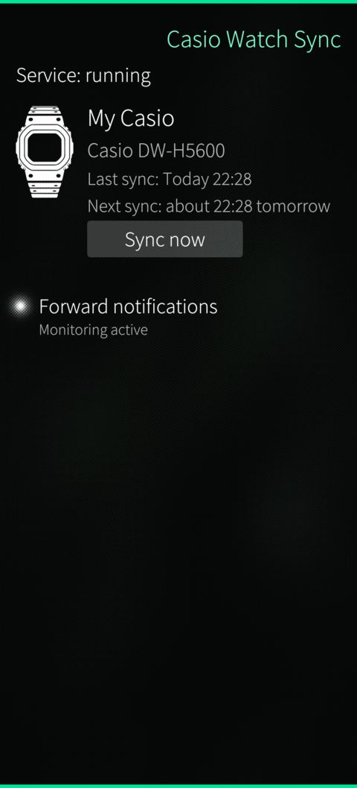
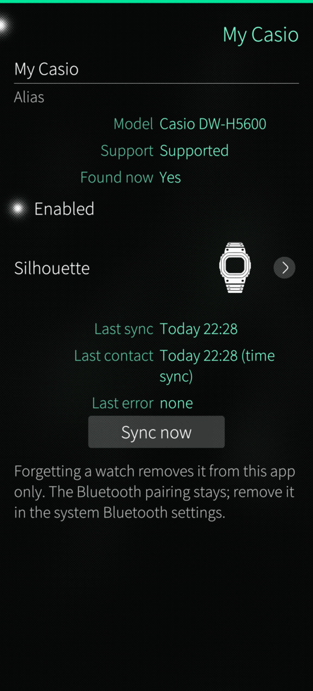
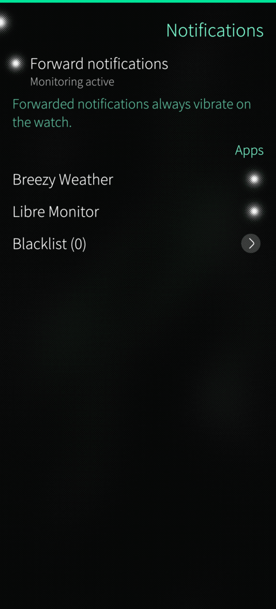

# Casio Watch Sync (CWS)

Casio Watch Sync is a Sailfish OS application that sets the time of a Casio Bluetooth watch from the phone clock and forwards phone notifications to the watch. The first target is the **Casio DW-H5600**.

> Casio Watch Sync is an unofficial application. It is not affiliated with, endorsed by or supported by Casio. Casio and the watch model names are trademarks of their owners.

- Repository: <https://github.com/mbrami76/sfos-casio-watch-sync>
- Package name: `sfos-casio-sync`
- Licence: GPL-3.0-or-later (see [LICENSE](LICENSE))
- Language of the user interface: English (version 1.0.0)

## What it does

- **Time sync**: writes the phone's local date and time to the watch on a schedule (6 h, 12 h, 1 day, 2 days, 1 week, 2 weeks, 30 days) or on demand.
- **Notifications**: forwards notifications posted on the phone to the watch (sender and text, truncated to the watch frame limit), with a per-application blacklist.
- **Several watches**: each paired watch has its own settings and its own silhouette picture.
- **Background service**: one binary, started with `--service`, runs without the user interface and is woken by the system when a sync is due.

On the watch, a forwarded notification raises a pop-up, vibration and sound, unless these are disabled in the watch settings.

## Screenshots

<p>
  
  
  
</p>

## Requirements

- Sailfish OS 5.x (developed and tested on Sailfish OS 5.2, BlueZ 5.87).
- A Casio watch that uses the Casio "2C/2D" Bluetooth LE service layout, already paired with the phone from the Bluetooth settings. Only the DW-H5600 has been verified.

## This is not a Harbour application

Reading the notifications of other applications requires monitoring the session D-Bus, which the Sailfish sandbox does not allow. The application therefore ships with `Sandboxing=Disabled` and cannot be published in the Jolla Harbour store. It is distributed as an RPM.

## Building

The project is built with the Sailfish SDK (tested with 3.13.5) and qmake. Keep shadow builds outside the source tree.

```
mkdir ../build-i486 && cd ../build-i486
sfdk -c target=SailfishOS-5.1.0.11-i486 build-shell \
    qmake ../<source-dir>/sfos-casio-sync.pro CONFIG+=hostbuild
sfdk -c target=SailfishOS-5.1.0.11-i486 build-shell make check
```

`CONFIG+=hostbuild` builds the host-only tests, which need neither a phone nor a watch.

### Packages

The RPM is described by `rpm/sfos-casio-sync.spec`. Build one package per target, one after the other (two SDK builds must not run at the same time), each in its own empty directory outside the source tree:

```
# phone (aarch64)
mkdir ../build-aarch64 && cd ../build-aarch64
sfdk -c target=SailfishOS-5.1.0.11-aarch64 build-init
sfdk -c target=SailfishOS-5.1.0.11-aarch64 build ../<source-dir>

# emulator (i486)
mkdir ../build-i486-rpm && cd ../build-i486-rpm
sfdk -c target=SailfishOS-5.1.0.11-i486 build-init
sfdk -c target=SailfishOS-5.1.0.11-i486 build ../<source-dir>
```

The packages are written to `RPMS/` in the build directory, for example `RPMS/sfos-casio-sync-1.0.0-1.aarch64.rpm`. Install on the phone as root with `rpm -U --force <file>`, or deploy with `sfdk deploy --sdk`. Use the target names that `sfdk tools list` shows if your SDK has a different Sailfish OS version.

Packages you build yourself are unsigned; the official release RPMs are signed (see [Releases](#releases)).

## To do

- [ ] Test with two or more watches (sequential sessions, several watches of the same model).
- [ ] Version 2: compatibility wizard for untested watch models, with an anonymised log the user can send to the developer.
- [ ] Version 2: activity data (steps, heart rate, SpO2) with an exportable archive.
- [ ] Version 2: in-app management of watch settings, alarms, time zone / DST / world cities and reminders.
- [ ] Version 2: translations (strings are already marked for translation).

## Documentation

- [Architecture](docs/architecture.md): modules, processes, D-Bus API, data flows.
- [Who does what](docs/who-does-what.md): every source file and its responsibility.
- [Reverse engineering](docs/reverse-engineering.md): how the watch protocol was investigated, and the projects credited.
- [Contributing](CONTRIBUTING.md) and [Security policy](SECURITY.md).

- [Requirements](docs/requirements.md): the numbered requirements (`R-…`) cited in the source comments.

## Releases

Release RPMs are signed with GPG. Key fingerprint:

```
BFA55D0C855566B86CC46C09199EBE6300A946B6
```

The public key is in [SIGNING-KEY.asc](SIGNING-KEY.asc). Check that the fingerprint above matches, then verify a package:

```
rpm --import SIGNING-KEY.asc
rpm --checksig <file>.rpm
```

or verify the detached signature published with the release:

```
gpg --import SIGNING-KEY.asc
gpg --verify <file>.rpm.asc <file>.rpm
```

## Tests

Each module has a QtTest program under `tests/`. Three small command-line tools (`watchlink-cli`, `notifmonitor-cli`, `wakeprobe`) are for manual checks on a real phone and are not run by `make check`.

## Privacy

Settings and state are stored locally. No notification text is logged or stored beyond a short in-memory queue (10 items, discarded after 5 minutes).

## Development

The development of this project included generative AI tools.

## Support

If you find this application useful, you can support my free and open-source work on GitHub through Liberapay: <https://liberapay.com/mbrami76>

## Licence

Copyright (C) 2026 Michele Brami. Released under the GNU General Public License, version 3 or later.
