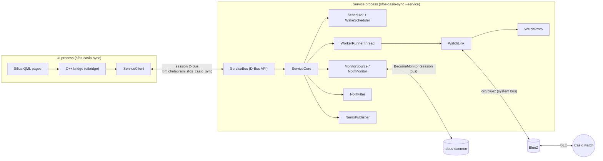
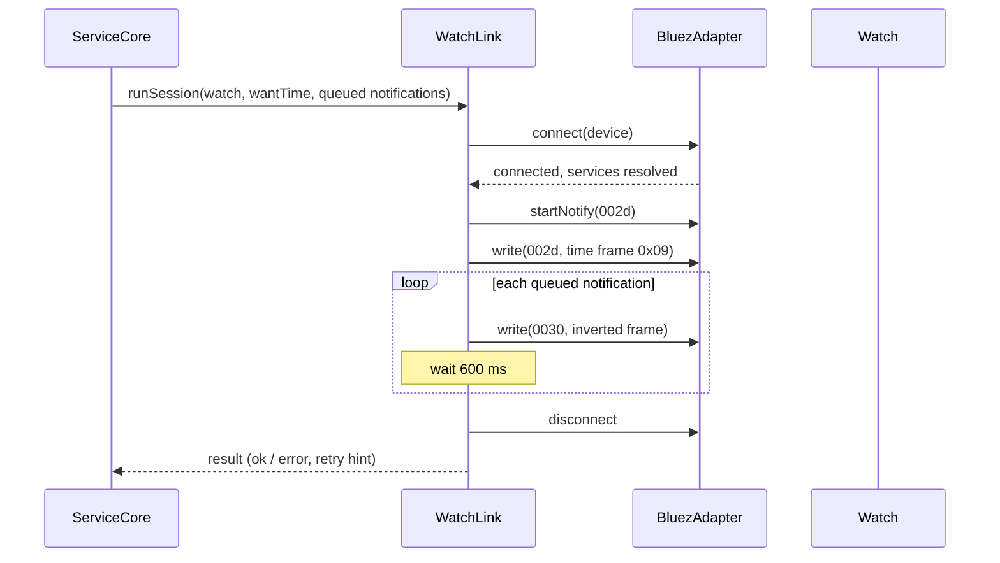
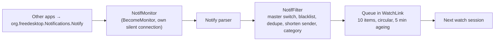

# Architecture

## 1. Overview

CWS is one executable, `sfos-casio-sync`, that runs in two modes:

- **UI mode** (default): a Silica QML application. It holds no Bluetooth logic.
- **Service mode** (`--service`): a headless background process that owns the Bluetooth sessions, the schedule and the notification monitor.

The two processes talk over the session D-Bus. The UI is a thin client of the service; it can be closed at any time without stopping syncs.

## 2. Layers

| Layer | Directory | Rule |
|---|---|---|
| Core | `core/` | Static library. Protocol, rules, settings, scheduling, BlueZ access. No UI, no process wiring. Pure modules have no Qt event-loop dependency and are tested on the host. |
| Service | `service/` | Wires the core modules together through injected interfaces (seams) and exposes the D-Bus API. |
| App | `app/` | Qt/QML user interface and the C++ bridge static library it uses. |
| Data | `data/`, `rpm/` | Desktop file, D-Bus activation file, systemd units, icons, model table, RPM spec. |

Every external dependency is behind a small interface so that the logic can be tested on a desktop without a phone: `BluezAdapter` (Bluetooth), `SessionRunner` (session execution), `NotifSource` (notification input), `StatusPublisher` (status output), `WakeScheduler` (system wake-ups), `ClockSource` (time).

## 3. Watch protocol (WatchProto, WatchLink)

The watch exposes a vendor GATT service. CWS uses three characteristics:

| Characteristic | Use |
|---|---|
| `26eb002c` | Feature requests from the phone (write without response). |
| `26eb002d` | Answers from the watch (notify) and the time write. |
| `26eb0030` | Notifications to the watch; every byte of the frame is inverted. |

Time is written as feature `0x09`, 11 bytes: id, year (2 bytes, little endian), month, day, hour, minute, second, day of week, a reserved byte and an adjust-reason byte. The frame carries wall-clock fields only; there is no time zone.

Notification frames are limited to 214 bytes; text is truncated on UTF-8 character boundaries. The watch needs about 600 ms between notification writes, so `WatchLink` paces them.

`WatchProto` builds and checks frames and has no I/O. `WatchLink` owns one session at a time:

The watch rejects malformed frames silently, so the app validates every frame before sending. A connection empties the watch's notification list, so the queue is delivered inside one session. Sessions last about 46 s. Failed sessions are retried after 30 s, 1, 2 and 4 min.

## 4. Scheduling

`Scheduler` is pure logic: given the last success time, the interval and the number of consecutive failures, it says whether a sync is due and when to wake next. Back-off after failures is 5 min, 15 min, 1 h, then the smaller of 24 h and the configured interval.

`WakeScheduler` wraps the system background-activity (wake-up) API with `hold()` and `release()`: the device is held awake only while a session runs. A systemd user timer and a plain D-Bus activation file make sure the service is started when needed.

## 5. Notifications

- `NotifMonitor` opens a separate D-Bus connection and becomes a monitor, so it receives copies of `Notify` calls without being a notification server and without making noise. This is why the app cannot be sandboxed.
- `NotifFilter` is pure: it applies the master switch, the per-application blacklist and formatting rules, and picks the icon category. The category table is empty by default; every notification uses category 0.
- The monitor reconnects with delays from 1 s up to 1 min.
- `NemoPublisher` shows the service status as a resident notification.

## 6. Settings and state

| Item | Location |
|---|---|
| Settings (INI) | `~/.config/it.michelebrami/sfos-casio-sync.conf` |
| State (JSON) | `~/.local/share/it.michelebrami/sfos-casio-sync/state.json` |
| Model table | `/usr/share/sfos-casio-sync/models.json` |

Watches are identified by name and GATT service, not by Bluetooth address, because BlueZ may re-create the device object under a new address. The model table maps a model name to its defaults (for example the default silhouette). The picture shown for a watch is the user's own choice if set, otherwise the model default, otherwise `classic`.

## 7. D-Bus API

Session bus; name `it.michelebrami.sfos_casio_sync`, path `/it/michelebrami/sfos_casio_sync`, interface `it.michelebrami.sfos_casio_sync`.

| Member | Kind | Purpose |
|---|---|---|
| `GetStatus` | method | Current state: per-watch last sync, next sync, errors. |
| `SyncNow(s)` | method | Start a time sync for the given watch. |
| `ReloadSettings` | method | Re-read the settings file. |
| `TestNotification` | method | Send a test notification to the watch. |
| `ListWatches` | method | Paired watches known to BlueZ. |
| `OpenApp` | method | Ask the UI to show itself. |
| `StatusChanged` | signal | Emitted when the status changes. |

The UI itself is single-instance through the session bus name `it.michelebrami.sfos_casio_sync.ui` and its `Activate()` method.

## 8. User interface

QML pages: Status, Watches, Watch detail, Silhouette, Notifications, Blacklist, Settings, About, and two dialogs (notice, risk). The C++ bridge exposes a single context property, `cws`, with list models for watches and applications. Watch pictures are generic drawings; no real watch model is depicted.

## 9. Packaging

Hand-written RPM spec (`rpm/sfos-casio-sync.spec`, qmake with `CWS_VERSION` and `CWS_URL`). The desktop file sets `Sandboxing=Disabled`. Installed files: the binary, the desktop file, the D-Bus activation file, the systemd user units, icons (86, 108, 128, 172 px), `models.json`.

## 10. Testing strategy

Logic is tested on the host with QtTest against fake seams (fake Bluetooth adapter, fake clock, fake notification source). Hardware behaviour is checked with the command-line tools in `tests/` on a real phone.
